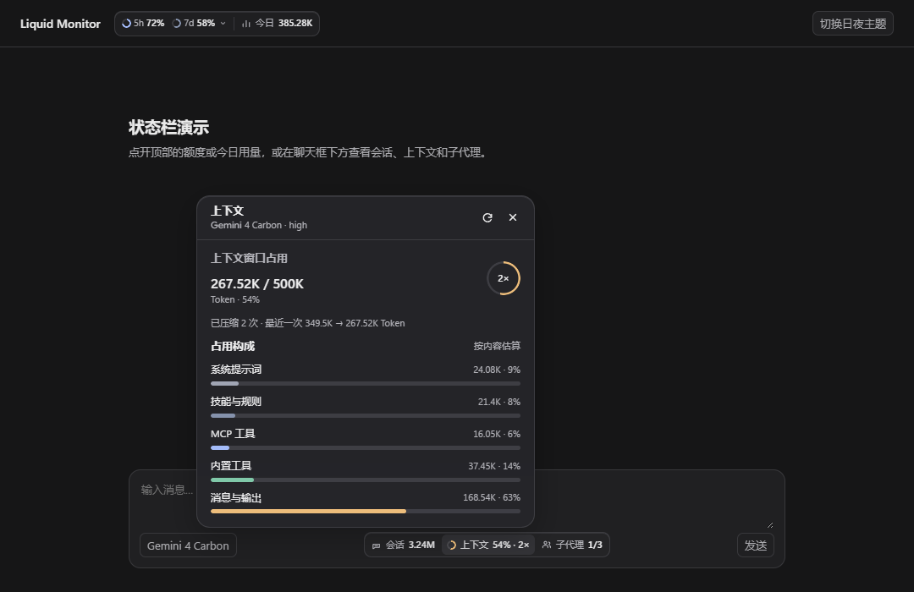
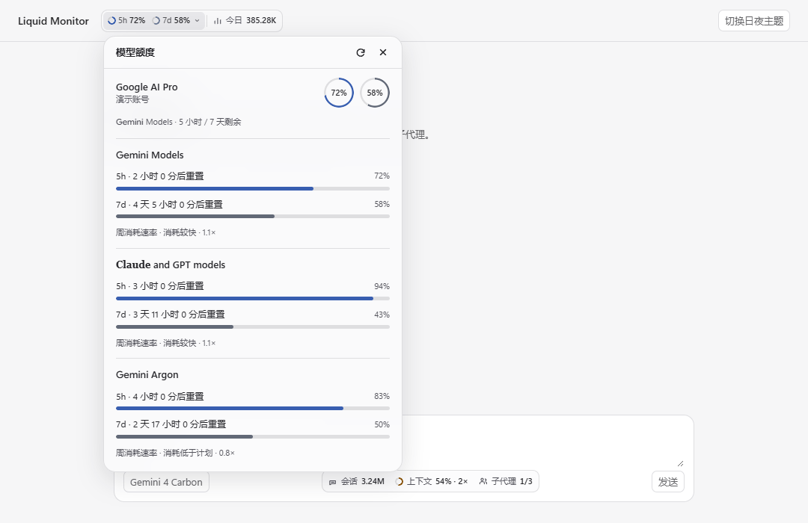

<div align="center">


# AGY Liquid Monitor

[简体中文](README.md) · **English**

**Usage monitoring for Antigravity Desktop on Windows and macOS**

See remaining model quota, session tokens, context usage, and subagent activity in a compact glass status bar.

<p align="center">
  <a href="https://github.com/Seth-Worange/agy-liquid-monitor/releases/latest/download/agy-liquid-monitor-windows.zip"></a>
  <a href="https://github.com/Seth-Worange/agy-liquid-monitor/releases/latest/download/agy-liquid-monitor-macos.zip"></a>
</p>

[Installation](#installation) · [Release notes](https://github.com/Seth-Worange/agy-liquid-monitor/releases)

[](#installation)
[](#installation)
[](LICENSE)

</div>

<p align="center">
  
  
</p>
<p align="center"><sub>Click the quota or daily token count in the title bar for details. The status bar follows the host's light and dark themes by default.</sub></p>

## Features

- **Title bar** shows remaining 5-hour and 7-day quota and today's token count. It checks every 12 seconds while the window is visible and again when you return to it.
- **Chat composer** shows session tokens, turns, model calls, cache hit rate, time to first token, and output speed.
- **Context panel** shows context window usage, compaction history, and estimated usage by category, including system prompts, rules, MCP tools, and messages.
- **Subagent panel** shows status, model, and context usage for each subagent.
- **Orchestrator** shows the latest turn's planner and executor, usage by role, and model call sequence in session details. Conversations with multiple orchestration turns also show cumulative usage. Calls with an ambiguous role are listed separately.
- **Plugins dashboard** shows quota, sessions, and usage history for the last 7 days, the last 30 days, or all recorded activity.
- **Native styling** uses the host's typography and a translucent glass surface.

## Appearance settings

Open **Appearance Settings** from the title bar or the top right of the dashboard. Follow Antigravity's theme or choose light, dark, pink, or green. Pink and green follow the host's brightness. The sliders adjust glass transparency (0–65%) and blur strength (0–100%) in real time. Lower blur settings preserve background detail. You can restore the defaults. The title bar and dashboard share locally saved settings.

## Installation

Requires Antigravity Desktop 2.x and **Node.js 22.13 or later**. Both platforms share the status bar, Plugins dashboard, and calculations.

### Windows

1. [Download the Windows ZIP](https://github.com/Seth-Worange/agy-liquid-monitor/releases/latest/download/agy-liquid-monitor-windows.zip) and extract it, or clone the repository.
2. Quit Antigravity completely, including its system tray process.
3. Open PowerShell in the `agy-liquid-monitor` directory and run:

   ```powershell
   npm run hud:check
   npm run hud:install
   ```

4. Reopen Antigravity.

For a custom installation location:

```powershell
npm run hud:check -- --target "D:\Apps\Antigravity\resources\app.asar"
npm run hud:install -- --target "D:\Apps\Antigravity\resources\app.asar"
```

### macOS

The installer targets the official **Antigravity 2.35.2** builds for Apple Silicon and Intel. First launch, permission prompts, and an official upgrade on macOS 27 still need verification on a Mac.

1. [Download the macOS ZIP](https://github.com/Seth-Worange/agy-liquid-monitor/releases/latest/download/agy-liquid-monitor-macos.zip) and extract it, or clone the repository.
2. Quit Antigravity completely with **⌘Q**.
3. Open Terminal in the `agy-liquid-monitor` directory and run:

   ```bash
   npm run hud:check
   npm run hud:install
   open -a Antigravity
   ```

The installer looks in `/Applications` and `~/Applications`. For a custom location, point `--target` at the archive inside the app bundle:

```bash
npm run hud:install -- --target "$HOME/Applications/Antigravity.app/Contents/Resources/app.asar"
```

Patching `app.asar` invalidates the original macOS app signature until the archive is restored. Backups are stored under `~/Library/Application Support/AGY Liquid Monitor/`. If macOS declines to launch the modified app, quit Antigravity and restore the original archive. The Plugins dashboard works independently of the HUD.

### Restore the original app

The installer checks and backs up the original archive. Quit Antigravity completely and run:

```text
npm run hud:restore
```

### Reinstall the HUD after an Antigravity update

Click **Update and Restart** in Antigravity. On supported builds, Liquid Monitor waits for the official updater to replace the app, checks the updated version, reinstalls the HUD, and then reopens Antigravity. Check the `updateHandoff` field from `npm run hud:check` to see whether the update integration is available.

If the new build is incompatible, Antigravity opens with its original archive. After an external or unsupported update, run `npm run hud:check` and `npm run hud:install` again. Keep the Node.js installation used by the HUD installer.

The latest update result is saved to `%LOCALAPPDATA%\AGY Liquid Monitor\last-update.log` on Windows or `~/Library/Application Support/AGY Liquid Monitor/last-update.log` on macOS.

### Open the Plugins dashboard

The optional MCP dashboard requires Antigravity App **2.34.0 or later**. Install it from the project or extracted package directory:

```text
agy plugin install .
```

In a conversation, use **+ → Plugins → Liquid Monitor** in the right sidebar. To open the full dashboard, use **Overview → Plugins → Liquid Monitor**.

The overview shows the current conversation when the host supplies its ID. If you open the dashboard manually and no ID is available, it labels the most recent session and lets you choose another. The visible dashboard refreshes every 20 seconds and when you return to it. In the heatmap, use the arrow keys to move between dates and Enter to filter the details.

## Dashboard metrics

| Area | Metrics |
| --- | --- |
| Session | Total tokens, turns, model and reasoning effort, cache hit rate, time to first token, and output speed |
| Context | Context window usage, compaction history, and estimated usage from prompts, skills, rules, tools, and messages |
| Subagents | Task count, status, model, and context usage |
| Quota | 5-hour and 7-day quota, account plan, shared quota pools, reset countdowns, and consumption rate |
| Usage history | Tokens, estimated costs, activity heatmap, breakdown by model, and top sessions for 7 days, 30 days, or all recorded activity |

## Data and privacy

- Conversation history comes from `conversation_summaries.db` and `conversations/*.db` under `%USERPROFILE%\.gemini\antigravity` on Windows or `~/.gemini/antigravity` on macOS. The plugin reads the databases without modifying them and keeps its incremental index in memory.
- Live sessions, account plans, and quota come from the local Antigravity service at `127.0.0.1`. Saved conversation history remains available when the service is offline.
- Costs are estimates based on built-in API rates. Context categories are estimates based on the available content.
- The plugin requires no API key. Available data depends on the Antigravity version, sign-in status, and local records.

## Preview and development

```text
npm run preview
npm test
npm run build
```

The preview uses sample data. There are no npm runtime dependencies. Shared calculations, local data access, and UI live in `src/core`, `src/main`, and `src/ui`. Platform-specific installation and backup rules live in `scripts/platforms`. Update integrations live in `src/platforms`.

## License and credits

Released under the [MIT License](LICENSE). Parts of the calculations and data parsing are adapted from [ag-vario](https://github.com/Staaaying/ag-vario). The quota and local service integration reference [Antigravity Context Viewer](https://github.com/elviscjn-cjn/antigravity-context-viewer). Google Sans Flex is included under the SIL Open Font License. [Third-party notices](THIRD_PARTY_NOTICES.md)

Antigravity, Gemini, Claude, and GPT are products or trademarks of their respective owners. AGY Liquid Monitor is an independent community plugin.
