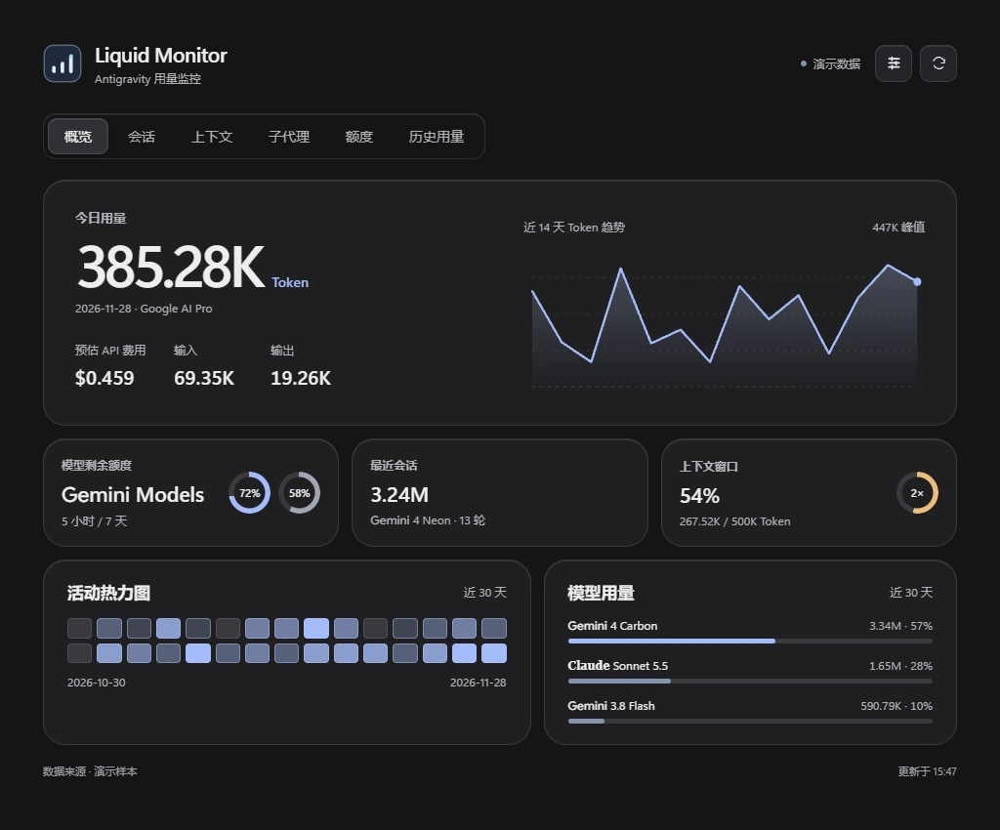
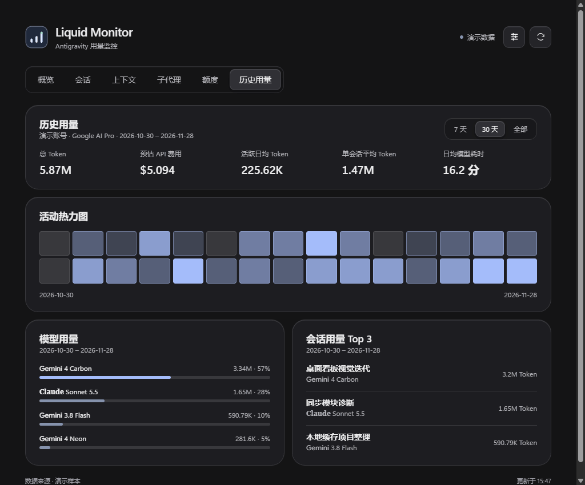
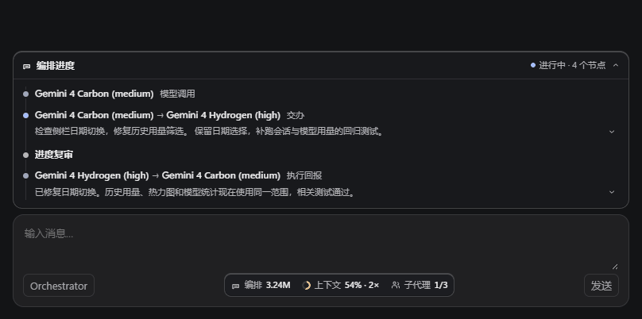
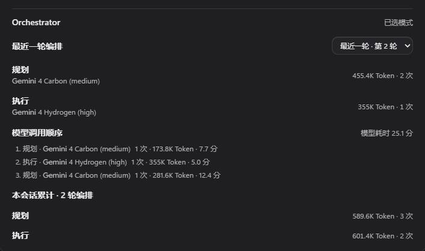
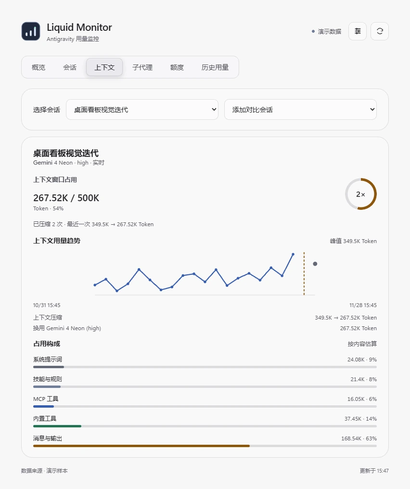
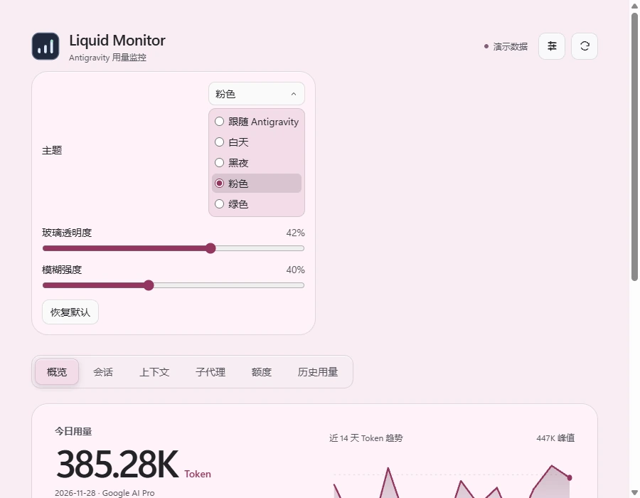

<div align="center">


# AGY Liquid Monitor

**简体中文** · [English](README.en.md)

**Antigravity Desktop 的 Windows / macOS 用量监控插件**

用半透明状态栏查看模型额度、会话 Token、上下文和子代理。开启 Orchestrator 后，可在当前对话跟进模型交办和执行回报。

<p align="center">
  <a href="https://github.com/Seth-Worange/agy-liquid-monitor/releases/latest/download/agy-liquid-monitor-windows.zip"></a>
  <a href="https://github.com/Seth-Worange/agy-liquid-monitor/releases/latest/download/agy-liquid-monitor-macos.zip"></a>
</p>

[效果演示](#效果演示) · [对话内编排](#对话内编排进度) · [安装说明](#安装) · [版本记录](https://github.com/Seth-Worange/agy-liquid-monitor/releases)

[](#安装)
[](#安装)
[](LICENSE)

</div>

## 效果演示

以下截图和动图使用本地演示数据。

### 顶部和聊天框状态栏

<p align="center">
  
  
</p>

顶部显示模型额度和今日用量，聊天框附近显示会话、上下文和子代理。点击对应指标展开详情。

### 侧栏看板与历史用量





切换 **7 天、30 天、全部**，热力图、模型排名和热门会话随范围一起更新。点选热力图中的一天可查看当日数据。

### 对话内编排进度



在当前会话的模型菜单选用 **Orchestrator**，再展开输入框上方的「编排进度」。卡片按时间显示本轮的交办、执行回报和复审。点开一条交办或回报，可阅读会话里记录的内容。仅记录到模型切换时，卡片会显示接手方向。

### 在侧栏回看编排轮次



打开侧栏的「会话」，在 Orchestrator 区块切换已记录的轮次，查看规划和执行各用了多少 Token、调用顺序及模型耗时。

### 上下文趋势与外观设置

<p align="center">
  
  
</p>

上下文趋势标出压缩前后的读数与模型切换。外观设置可调整主题、玻璃透明度和模糊强度。

## 功能

- **顶部状态栏**：显示 5 小时、7 天额度和今日 Token，窗口可见时每 12 秒检查更新，回到窗口时也会刷新。点击可查看额度和用量明细。
- **会话状态**：在聊天框下方查看 Token、对话轮数、模型调用、缓存命中、首字延迟和输出速度。
- **上下文检查**：查看窗口占用、压缩前后的用量趋势及模型切换，以及系统提示词、技能规则、MCP 工具和消息等内容的估算占比。
- **子代理状态**：查看运行状态、模型与上下文占用。
- **Orchestrator**：会话详情默认显示最近一轮，可在侧栏切换到任意已记录的编排轮次，查看模型调用顺序、用量和耗时。多轮编排另显示会话累计，无法区分角色的调用会单独显示。
- **对话内编排进度**：选用 Orchestrator 后，输入框上方出现可折叠的卡片，显示本轮交办、执行回报和复审记录。点开交办或回报可阅读已记录的内容。
- **用量看板**：在 Antigravity 侧栏查看额度、会话与历史趋势；支持 7 天、30 天和全部周期。
- **原生主题**：沿用宿主字体与日夜主题，采用轻量半透明材质。

## 外观设置

点击顶部状态栏或完整看板右上角的**外观设置**图标。主题默认跟随 Antigravity，也可固定为白天或黑夜。粉色和绿色主题会随宿主切换明暗。玻璃透明度（0–65%）和模糊强度（0–100%）拖动即生效，可一键恢复默认。模糊滑块在低档保留背景细节，接近上限时逐渐加重。状态栏和看板共用同一份本地设置。

在「语言 / Language」中选择**简体中文**或 **English**。状态栏、对话内编排卡片和侧栏共用这个设置。会话标题和编排记录保留原文。

## 安装

需要 Antigravity Desktop 2.x 和 Node.js **22.13 或更高版本**。Windows 和 macOS 共用状态栏、Plugins 看板以及统计逻辑。

### Windows

1. 从 [GitHub Releases 下载 Windows 安装包](https://github.com/Seth-Worange/agy-liquid-monitor/releases/latest/download/agy-liquid-monitor-windows.zip)，解压后进入 `agy-liquid-monitor` 目录。也可以直接克隆仓库。
2. 完全退出 Antigravity（包括托盘中的进程）。
3. 在仓库或解压目录打开 PowerShell，执行兼容检查，再安装状态栏：

   ```powershell
   npm run hud:check
   npm run hud:install
   ```

安装程序会验证并备份原始应用归档。要还原原版，在 Antigravity 完全退出后运行：

```powershell
npm run hud:restore
```

自定义安装位置：

```powershell
npm run hud:check -- --target "D:\Apps\Antigravity\resources\app.asar"
npm run hud:install -- --target "D:\Apps\Antigravity\resources\app.asar"
```

### macOS

适配 Apple Silicon 和 Intel 的 Antigravity **2.35.2** 官方应用结构，安装命令在原生终端运行。macOS 27 的首次启动、权限提示与一次真实升级仍需 Mac 实机验证。

1. [下载 macOS 安装包](https://github.com/Seth-Worange/agy-liquid-monitor/releases/latest/download/agy-liquid-monitor-macos.zip)，或克隆仓库。
2. 用 **⌘Q** 完全退出 Antigravity。解压安装包，在终端进入 `agy-liquid-monitor`，执行：

   ```bash
   npm run hud:check
   npm run hud:install
   open -a Antigravity
   ```

安装器会查找 `/Applications/Antigravity.app` 或 `~/Applications/Antigravity.app`。自定义位置可用 `--target` 指向应用内的归档：

```bash
npm run hud:install -- --target "$HOME/Applications/Antigravity.app/Contents/Resources/app.asar"
```

HUD 会改变应用包中的 `app.asar`，因此运行中的修改版应用不再通过原始签名校验。安装器保留签名材料，备份存于 `~/Library/Application Support/AGY Liquid Monitor/`。如果系统拒绝打开修改版，退出后运行 `npm run hud:restore` 恢复官方归档与签名，仍可通过正式 Plugins 入口使用看板。

### 随客户端更新自动重装

安装 HUD 后，照常点击 Antigravity 内的「更新并重启」。Windows 交给官方 NSIS 安装器，macOS 等待应用自带的 Squirrel 更新器完成替换。Liquid Monitor 随后检查新版本的兼容性，用本机已安装的副本恢复状态栏，再打开 Antigravity。可以用 `npm run hud:check` 查看 `updateHandoff`。升级到新的 Liquid Monitor 版本时，请先安装对应版本。

如果新版不兼容，更新后的 Antigravity 会直接打开。手动安装更新或更新入口不匹配时，可以重新运行 `npm run hud:check` 和 `npm run hud:install`。请保留安装 HUD 时使用的 Node.js。最近一次自动更新的结果记录在 Windows 的 `%LOCALAPPDATA%\AGY Liquid Monitor\last-update.log` 或 macOS 的 `~/Library/Application Support/AGY Liquid Monitor/last-update.log`。

### 打开完整看板

可选安装 MCP 看板：

```powershell
agy plugin install .
```

进入任一会话后，在右侧栏选择 **+ → Plugins → Liquid Monitor**。也可以从 **Overview → Plugins → Liquid Monitor** 打开全页看板。MCP 看板需要 Antigravity App 2.34.0 或更高版本。

宿主提供会话 ID 时，概览显示「当前对话」。手动打开看板且宿主未提供会话 ID 时，概览标为「最近会话」，点击该卡片可选其他会话。可见的看板每 20 秒检查更新，切回时也会刷新。热力图可用方向键移动到日期，按 Enter 筛选明细。

## 看板指标

| 区域 | 内容 |
| --- | --- |
| 会话 | 累计 Token、对话轮数、模型与推理档位、缓存命中率、首字延迟、输出速度 |
| 上下文 | 使用率、压缩记录、系统提示词、技能与规则、MCP/内置工具及消息占比估算 |
| 子代理 | 运行状态、模型、上下文占用和任务数量 |
| 额度 | 5 小时与 7 天额度、账户套餐、共享额度池、重置倒计时和消耗速度 |
| 历史用量 | 7 天、30 天及全部周期；Token、预估费用、热力图、模型分布和会话排行 |

## 数据说明

- 历史记录从 Windows 的 `%USERPROFILE%\.gemini\antigravity` 或 macOS 的 `~/.gemini/antigravity` 只读读取，包括 `conversation_summaries.db` 和 `conversations/*.db`。增量索引保存在内存中。
- 实时会话、套餐和额度通过 Antigravity 已启动的本地服务获取，连接范围限于 `127.0.0.1`。离线时仍可查看已有历史记录。
- 费用根据内置 API 单价估算，不等同于订阅账单；上下文类别是可读取内容的估算值。
- 插件不会要求 API Key。实际可见数据取决于 Antigravity 版本、登录状态及本地记录。

## 预览与开发

无需安装插件即可在浏览器查看演示界面：

```powershell
npm run preview
```

演示使用虚构数据。常用开发命令：

```powershell
npm test
npm run build
```

项目没有 npm 运行时依赖。`src/core`、`src/main` 和 `src/ui` 分别负责共享计算、本地数据与界面。`scripts/platforms` 存放两端安装与备份规则，`src/platforms` 存放两端的更新入口。

## 许可与致谢

本项目采用 [MIT License](LICENSE)。部分计算及数据解析逻辑改编自 [ag-vario](https://github.com/Staaaying/ag-vario)，额度和本地服务协议参考 [Antigravity Context Viewer](https://github.com/elviscjn-cjn/antigravity-context-viewer)；Google Sans Flex 字体遵循随附的 SIL Open Font License。第三方版权和许可文本见 [THIRD_PARTY_NOTICES.md](THIRD_PARTY_NOTICES.md)。

Antigravity、Gemini、Claude 和 GPT 为各自权利人的产品或商标。本项目为社区插件，与 Google、Anthropic 或 OpenAI 无隶属关系。
