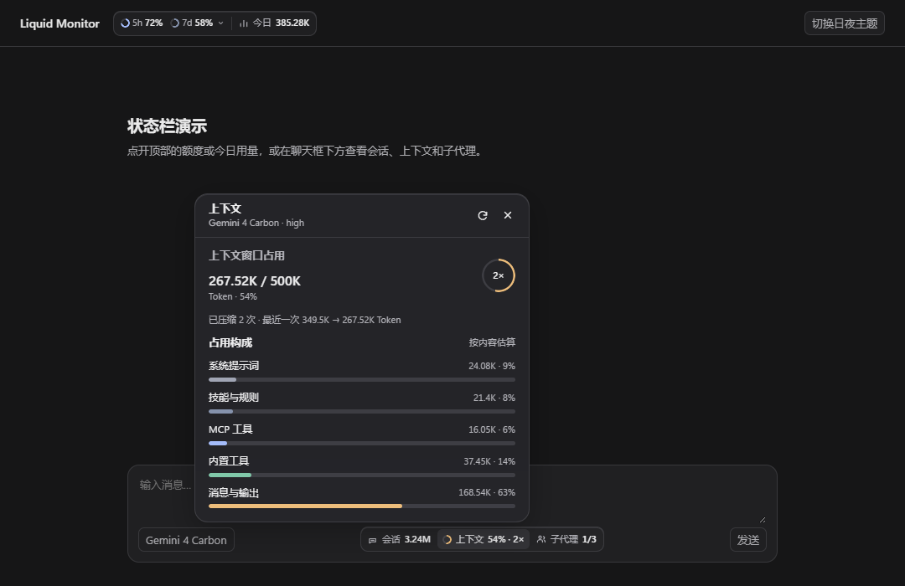
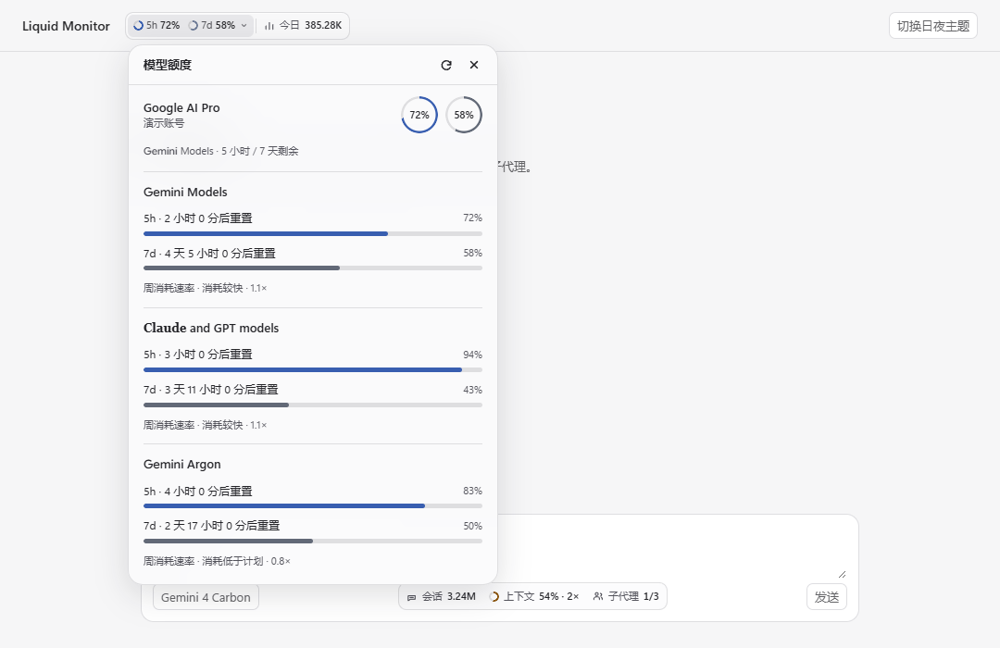

<div align="center">


# AGY Liquid Monitor

**Antigravity Desktop 的 Windows 用量监控插件**

简洁的半透明状态栏，实时查看模型额度、会话 Token、上下文和子代理。

[](#安装)
[](#安装)
[](#安装)
[](LICENSE)

</div>

<p align="center">
  
  
</p>
<p align="center"><sub>状态栏贴合 Antigravity 顶栏；点击额度或今日用量即可展开明细，并跟随宿主浅色与深色主题切换。</sub></p>

## 功能

- **顶部状态栏**：显示 5 小时、7 天额度和今日 Token，窗口可见时每 12 秒检查更新，回到窗口时也会刷新。点击可查看额度和用量明细。
- **会话状态**：在聊天框下方查看 Token、对话轮数、模型调用、缓存命中、首字延迟和输出速度。
- **上下文检查**：查看窗口占用、压缩次数，以及系统提示词、技能规则、MCP 工具和消息等内容的估算占比。
- **子代理状态**：查看运行状态、模型与上下文占用。
- **用量看板**：在 Antigravity 侧栏查看额度、会话与历史趋势；支持 7 天、30 天和全部周期。
- **原生主题**：沿用宿主字体与日夜主题，采用轻量半透明材质。

## 外观设置

点击顶部状态栏或完整看板右上角的**外观设置**图标。主题默认跟随 Antigravity，也可固定为白天或黑夜。粉色和绿色主题会随宿主切换明暗。玻璃透明度（0–65%）和模糊强度（0–100%）拖动即生效，可一键恢复默认。模糊滑块在低档保留背景细节，接近上限时逐渐加重。状态栏与看板各自在允许本地存储的界面中保存设置。

## 安装

适用于 Windows 10/11 上的 Antigravity Desktop 2.x，已针对 **2.35.1** 验证。安装原生状态栏需要 Node.js **22.13 或更高版本**。

1. 从 [GitHub Releases 下载 Windows 安装包](https://github.com/Seth-Worange/agy-liquid-monitor/releases/latest/download/agy-liquid-monitor-windows.zip)，解压后进入 `agy-liquid-monitor` 目录。也可以直接克隆仓库。
2. 完全退出 Antigravity（包括托盘中的进程）。
3. 在仓库或解压目录打开 PowerShell，执行兼容检查，再安装状态栏：

   ```powershell
   npm run hud:check
   npm run hud:install
   ```

安装程序会验证并备份原始应用归档。客户端更新后，请重新检查兼容性并安装。要还原原版，在 Antigravity 完全退出后运行：

```powershell
npm run hud:restore
```

自定义安装位置：

```powershell
npm run hud:check -- --target "D:\Apps\Antigravity\resources\app.asar"
npm run hud:install -- --target "D:\Apps\Antigravity\resources\app.asar"
```

### 打开完整看板

可选安装 MCP 看板：

```powershell
agy plugin install .
```

进入任一会话后，在右侧栏选择 **+ → Plugins → Liquid Monitor**。也可以从 **Overview → Plugins → Liquid Monitor** 打开全页看板。MCP 看板需要 Antigravity App 2.34.0 或更高版本。

## 看板指标

| 区域 | 内容 |
| --- | --- |
| 会话 | 累计 Token、对话轮数、模型与推理档位、缓存命中率、首字延迟、输出速度 |
| 上下文 | 使用率、压缩记录、系统提示词、技能与规则、MCP/内置工具及消息占比估算 |
| 子代理 | 运行状态、模型、上下文占用和任务数量 |
| 额度 | 5 小时与 7 天额度、账户套餐、共享额度池、重置倒计时和消耗速度 |
| 历史用量 | 7 天、30 天及全部周期；Token、预估费用、热力图、模型分布和会话排行 |

## 数据说明

- 历史记录从 `%USERPROFILE%\.gemini\antigravity\conversation_summaries.db` 和 `conversations\*.db` 只读读取；增量索引保存在内存中。
- 实时会话、套餐和额度通过 Antigravity 已启动的本地服务获取，连接范围限于 `127.0.0.1`。离线时仍可查看已有历史记录。
- 费用根据内置 API 单价估算，不等同于订阅账单；上下文类别是可读取内容的估算值。
- 插件不会要求 API Key。实际可见数据取决于 Antigravity 版本、登录状态及本地记录。

## 预览与开发

无需安装插件即可在浏览器查看演示界面：

```powershell
npm run preview
```

演示使用虚构数据。常用开发命令：

```powershell
npm test
npm run build
```

项目没有 npm 运行时依赖。核心计算位于 `src/core`，Windows 数据读取与宿主桥接位于 `src/main`，状态栏和看板界面位于 `src/ui`。

## 许可与致谢

本项目采用 [MIT License](LICENSE)。部分计算及数据解析逻辑改编自 [ag-vario](https://github.com/Staaaying/ag-vario)，额度和本地服务协议参考 [Antigravity Context Viewer](https://github.com/elviscjn-cjn/antigravity-context-viewer)；Google Sans Flex 字体遵循随附的 SIL Open Font License。第三方版权和许可文本见 [THIRD_PARTY_NOTICES.md](THIRD_PARTY_NOTICES.md)。

Antigravity、Gemini、Claude 和 GPT 为各自权利人的产品或商标。本项目为社区插件，与 Google、Anthropic 或 OpenAI 无隶属关系。
